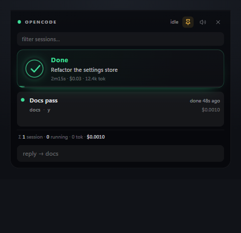
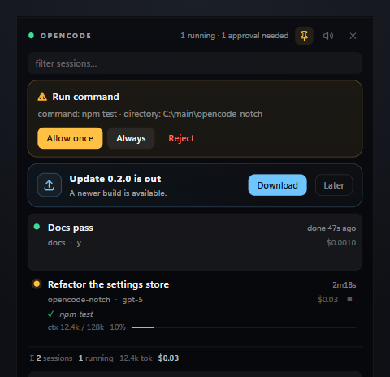
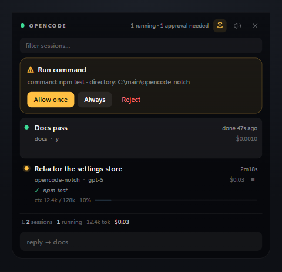
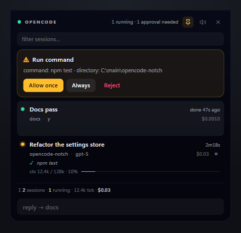

<div align="center">


# OpenCode Notch

**Notch в стиле macOS для Windows — для ваших сессий OpenCode.**

Подтверждения, формы, живая активность агента и расход контекста — всегда на виду, в верхней кромке экрана.

[](#требования)
[](https://opencode.ai)
[](https://www.electronjs.org)
[](LICENSE)
[](https://t.me/mrsdsxp)

[Скачать](#установка) · [Сайт](https://fraches05.github.io/opencode-notch/) · [Возможности](#возможности) · [Как это работает](#как-это-работает) · [Если что-то не работает](#если-что-то-не-работает) · [Чат](https://t.me/mrsdsxp)

**Русский** · [English](README.md)

</div>

<p align="center">
  
</p>

---

## Зачем это нужно

Когда OpenCode работает в терминале, вы постоянно переключаетесь на него, чтобы проверить одно и то же: *закончил он или ещё нет? ждёт моего подтверждения? что он вообще сейчас делает?*

OpenCode Notch выносит ответ на верхнюю кромку экрана — в виде маленькой чёрной капсулы. Она не мешает, пока агент не понадобится: тогда капсула раскрывается, показывает запрос и позволяет ответить, не уходя из приложения, в котором вы работаете.

Никаких плагинов, хуков и конфигов в проекте. Notch общается напрямую с локальным фоновым сервисом OpenCode.

## Возможности

- **Настоящий notch** — пилюля у верхней кромки экрана. Её можно перетащить куда угодно; если она прилипла к верху, верхние углы становятся прямыми и она «срастается» с экраном.
- **Наведение раскрывает, пин держит** — панель открывается при наведении или по `Ctrl+Alt+N`.
- **Подтверждения разрешений** — `Allow once` / `Always` / `Reject` прямо в notch, с мягким звуковым сигналом, чтобы не пропустить.
- **Интерактивные формы** — текст, числа, списки, чекбоксы, мультивыбор и условные поля рендерятся настоящими контролами; ответить и отправить можно не трогая терминал.
- **Строка живой активности** — что агент делает *прямо сейчас*: `… command: npm test`, `✓ edit: src/routes.ts` или фрагмент стримящегося рассуждения.
- **Расход контекста по сессии** — `ctx 89.6k / 200k · 45%` по последнему сообщению ассистента, плюс накопленные токены и стоимость в подвале.
- **Быстрый ответ** — печатайте ответ выбранной сессии прямо из notch.
- **Прервать** — остановить запуск из строки сессии, не переключая окна.
- **Много сессий** — точки статуса по каждой: работает, ждёт вас, готово, ошибка, повтор.
- **Центр сессий** — переименовывайте, архивируйте и восстанавливайте сессии, открывайте проект прямо в OpenCode TUI.
- **Проекты** — переключайте проекты, группируйте сессии, показывайте архив по требованию и ищите по метаданным.
- **Палитра команд** — `Ctrl/Cmd + K` открывает управление с клавиатуры; стрелки переключают сессии.
- **Адаптивная панель** — контекстные действия в строке и компактный режим для узких экранов.
- **Фильтр** — начните печатать, чтобы сузить длинный список сессий.
- **Мультимонитор и память позиции** — помнит, куда вы её перетащили, отдельно для каждого монитора.
- **Подтверждение завершения** — карточка в стиле Face ID выезжает, когда запуск закончился: время, стоимость, токены; мягкий звук, исчезает через четыре секунды.
- **Уведомления Windows** — нативный тост, когда долгий запуск (20 с и больше) закончился, а notch скрыт или курсор в другом месте. Отключается в трее.
- **Напоминание об обновлении, а не назойливость** — notch проверяет GitHub на новую версию и предлагает *Скачать* / *Позже*. «Позже» запоминает версию, про которую уже сказали, и плашка сама панель не раскрывает.
- **Три темы** — Notch, Midnight и Mono, выбираются в меню трея и сохраняются между запусками.
- **Два языка** — английский и русский интерфейс, выбор в меню трея, «как в системе» по умолчанию.
- **Иконка в трее** — показать / скрыть, закрепить, вернуть наверх, выключить звук, тема, язык, автозапуск, выход.
- **Автозапуск** — необязательный «запуск при входе», стартует скрытой, пока не понадобится.

## Скриншоты

<table>
<tr>
<td align="center" width="50%">
<br />
<sub>Три сессии — две работают, одна только что закончила</sub>
</td>
<td align="center" width="50%">
<br />
<sub>Форма от агента, заполненная прямо в notch</sub>
</td>
</tr>
<tr>
<td colspan="2" align="center">
<br />
<sub>Свёрнуто: только точки статуса и ничего лишнего</sub>
</td>
</tr>
</table>

### Когда запуск закончился



### Когда вышло обновление



### Три темы

<table>
<tr>
<td align="center" width="33%">
<br />
<sub><b>Notch</b> — зелёный акцент, по умолчанию</sub>
</td>
<td align="center" width="33%">
<br />
<sub><b>Midnight</b> — холоднее база, ярче точки</sub>
</td>
<td align="center" width="33%">
<br />
<sub><b>Mono</b> — грейскейл, цвет только у алертов</sub>
</td>
</tr>
</table>

## Установка

### Вариант А — установщик (рекомендую)

1. Откройте [**Releases**](../../releases/latest) и скачайте `OpenCodeNotch-Setup-0.3.0.exe`.
2. Запустите его. Он ставится только для текущего пользователя, поэтому UAC не спрашивает, и добавляет ярлыки в меню «Пуск» и на рабочий стол.
3. **OpenCode Notch** стартует сразу — в верхней части экрана появится чёрная капсула.

Настройки установщик хранит в `%APPDATA%\OpenCode Notch`, и при удалении не трогает их — на случай, если вернётесь.

### Вариант Б — портативный архив

1. Скачайте `OpenCodeNotch-win-x64.zip` из того же релиза.
2. Распакуйте в любое место (например, `C:\Program Files\OpenCode Notch` или на флешку).
3. Запустите **`OpenCode Notch.exe`**.

> **Windows может ругаться.** Ни одна из сборок не подписана, поэтому SmartScreen покажет *«Windows защитила ваш компьютер»* или *«Неизвестный издатель»*. Нажмите **Подробнее → Выполнить в любом случае**. Исходный код лежит в этом же репозитории, и вы можете собрать оба артефакта сами командами `npm run make` и `npm run dist`.

### Вариант В — запуск из исходников

Нужен [Node.js 20+](https://nodejs.org).

```powershell
git clone https://github.com/fraches05/opencode-notch.git
cd opencode-notch
npm install
npm start
```

Или просто дважды кликните **`start-notch.cmd`** — он сам поставит зависимости при первом запуске и запустит notch.

### Требования

- Windows 10 или 11
- Установленный [OpenCode](https://opencode.ai) 2.x с доступным фоновым сервисом. Notch находит сервис так же, как это делает TUI — обычно настраивать ничего не нужно.
- Ни плагинов, ни API-ключей, ни дополнительной конфигурации.

## Как пользоваться

| Действие | Как |
| --- | --- |
| Открыть панель | Навести курсор на пилюлю или нажать `Ctrl+Alt+N` |
| Оставить открытой | Клик по 📌 или `Ctrl+Alt+N` |
| Закрыть панель | Клик по ✕, `Esc` или увести курсор |
| Переместить | Перетащить пилюлю или шапку панели |
| Вернуть на место | Иконка в трее → **По центру сверху** |
| Ответить на запрос разрешения | `Разрешить` / `Всегда` / `Отклонить` |
| Ответить сессии | Выбрать строку, напечатать в поле снизу, `Enter` |
| Остановить запуск | Кнопка `■` в строке работающей сессии |
| Переименовать сессию | Навести на строку → `✎`, изменить название |
| Архивировать / восстановить | Навести на строку → `⌁` / `↶` |
| Открыть в TUI | Навести на строку → `↗` |
| Поиск и фильтр | Поле поиска, вкладки проектов или `Ctrl/Cmd + K` |
| Выключить звук | Иконка динамика или трей → **Без звука** |
| Сменить тему | Иконка в трее → **Тема** → **Notch** / **Midnight** / **Mono** |
| Сменить язык | Иконка в трее → **Язык** → **Как в системе** / **English** / **Русский** |
| Отключить тосты о завершении | Иконка в трее → **Уведомлять о завершении** |
| Проверить обновление | Иконка в трее → **Проверить обновления** (ещё при старте и раз в 6 ч) |
| Запускать с Windows | Иконка в трее → **Запуск при входе** |

Настройки хранятся в `%APPDATA%\OpenCode Notch\notch.json` (позиция, закрепление, звук, тема, язык, уведомления, отложенное обновление, автозапуск).

## Как это работает

```
┌──────────────────────────┐        ┌───────────────────────────────┐
│  Главный процесс Electron│  HTTP  │  Фоновый сервис OpenCode      │
│  @opencode/client        │ <────> │  найден на 127.0.0.1          │
│  · поиск сервиса         │        │  · сессии / разрешения        │
│  · SSE /api/event        │        │  · формы / модели / сообщения │
│  · свёртка состояния     │        └───────────────────────────────┘
├──────────────────────────┤
│  Рендерер (без сети)     │   ← снимки состояния + действия по IPC
└──────────────────────────┘
```

- Главный процесс находит запущенный сервис через `Service.discover()` и авторизуется через `Service.headers()` — тем же путём, что и штатные клиенты OpenCode.
- Он подписывается на поток серверных событий `/api/event` и превращает сырые события (`session.status`, `permission.asked`, `session.tool.called`, `form.created`, `session.usage.updated`, …) в компактный снимок для интерфейса.
- Рендерер только рисует этот снимок и отправляет действия обратно по IPC (`perm:reply`, `session:prompt`, `session:interrupt`, `form:reply`, …). Сеть ему недоступна.
- Окно следует за своим содержимым: это безрамочная прозрачная поверхность поверх всех окон, которая меняет размер под пилюлю или панель и перецентровывается при изменении размера.

**Приватность:** всё остаётся на вашей машине. Notch общается только с локальным сервисом OpenCode, не отправляет телеметрию и хранит лишь собственные настройки интерфейса.

## Если что-то не работает

**Пилюля не появляется**
Запустите OpenCode хотя бы раз, чтобы появился его фоновый сервис. Если notch пишет *reconnecting…*, выполните в терминале `opencode service status`.

**Наведение не раскрывает панель**
Кликните иконку в трее и выберите **Закрепить панель** (`Ctrl+Alt+N`) — заодно убедитесь, что окно там, где вы ожидаете. Если клавиши заняты другой программой, notch пробует по очереди `Ctrl+Shift+N`, затем `Ctrl+Alt+O`, затем `F9`.

**Окно не на том мониторе или за экраном**
Трей → **По центру сверху**. Позиция запоминается отдельно для каждого монитора.

**Ничего не происходит при клике на «Разрешить»**
Возможно, разрешение уже обработано в другом клиенте (TUI). Карточка исчезнет, как только сервер сообщит об ответе.

**Число контекста выглядит большим**
`ctx` — это размер последнего сообщения ассистента (prompt + чтение кэша + вывод), то есть реальная занятость контекста. В подвале — накопленные токены сессии, они включают каждое чтение кэша и растут быстро.

**Где логи?**
`%TEMP%\opencode-notch.log` — только запуск, подключение и ошибки рендерера.

## Похожие проекты

Жанр notch / Dynamic Island больше, чем этот репозиторий, и это хорошо:

- [lumiomac.app](https://lumiomac.app) — macOS-приложение, с которого всё началось; очень симпатичное, но только для macOS.
- [opencode](https://opencode.ai) — агент, для которого этот notch и сделан.
- Если вы на Mac, для агентов есть несколько отличных notch-приложений. Этот проект существует потому, что те не работают на Windows, и потому, что он общается с собственным API OpenCode, а не полагается на хуки или заголовки окон.

## Участие

Issues и pull requests приветствуются. Если OpenCode изменит API, это обычно проявится как `reconnecting…` в шапке — приложите к issue `%TEMP%\opencode-notch.log`.

Не знаете, с чего начать? Хорошие первые задачи:

- Акцентные темы / компактный режим
- Локализация
- Подпись кода, чтобы Windows перестал ругаться
- Более информативная телеметрия retry/backoff в тултипе трея

## Связаться

- **Telegram:** [@mrsdsxp](https://t.me/mrsdsxp) — самый быстрый способ; скриншоты, сырые идеи и «оно сломалось» — всё сюда.
- **GitHub:** [issues](https://github.com/fraches05/opencode-notch/issues) для того, что стоит оставить в поиске.
- **Что менялось:** [CHANGELOG.md](CHANGELOG.md) — по версиям.

## Дисклеймер

Это независимый неофициальный проект. Он не связан с OpenCode, lumiomac или другими notch-приложениями и не одобрен ими. «OpenCode» используется описательно — чтобы было понятно, с чем работает приложение.

Если оно сэкономило вам пару переключений окон — ⭐ помогает другим его найти.

## Лицензия

[MIT](LICENSE)
